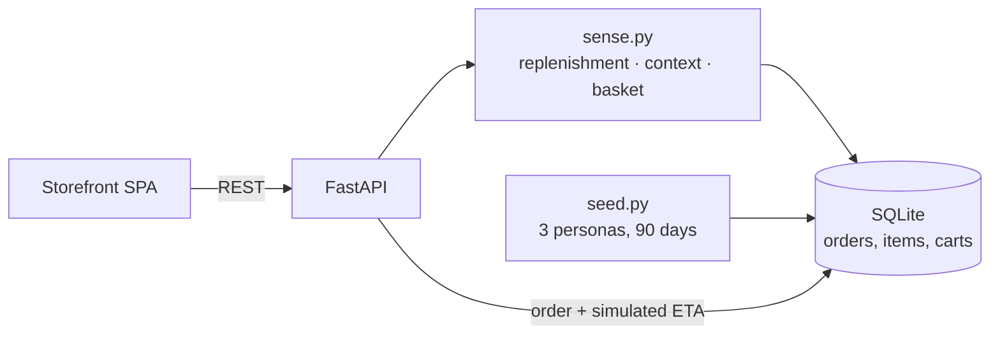

# cartsense ⚡

A Blinkit-style quick-commerce demo whose recommendation engine behaves like **human sense**: it predicts what you need *before you search* — and every suggestion comes with a plain-language reason you can check.

**The problem.** Quick-commerce apps (Blinkit, Zepto, Instacart, Getir) win on one thing: being faster than the shopper's own memory. But their "recommended for you" rails are opaque — shoppers don't trust suggestions they can't explain, and product teams can't debug a black box. cartsense shows that three small, fully interpretable signals cover most of what a heavyweight recommender does for a grocery basket, at near-zero inference cost.

## The three senses

| Sense | Signal | Example reason shown in the UI |
|---|---|---|
| 🔁 Replenishment | Your own buying rhythm: median days between purchases per product vs days since the last one | "You buy this about every 2 days — it has been 3" |
| 🕗 Context | Category lift in the current time-of-day bucket, from your history only | "You usually shop Dairy & Breakfast in the morning (×2.1 your average)" |
| 🧺 Basket | Co-purchase lift mined from all orders: lift(a→b) = P(b\|a)/P(b) | "Shoppers who buy Potato Chips pick this up ×3 more often" |

The "For you, right now" rail blends replenishment and context; the cart drawer uses basket sense. No embeddings, no model file — every score is reproducible from SQL rows by hand.



## Quick start

```bash
pip install -e ".[dev]"
python -m cartsense seed-demo   # 3 personas, 90 days of synthetic history
python -m cartsense serve       # http://127.0.0.1:8000
```

Or with Docker / Kubernetes:

```bash
docker compose up --build       # storefront on :8000
python ci.py k8s                # full deploy + smoke test on a local k3d cluster
```

Open the storefront, switch between the three personas (morning-routine Asha, weekly-bulk Rohan, evening-snacker Meera) and watch the sense rail change its mind — and its reasons — with the persona and the time of day.

## Pipeline

One `ci.py` holds every stage; GitHub Actions and the Jenkinsfile both just call it.

| Stage | What it proves |
|---|---|
| `lint` | ruff check + format |
| `unit` | 24 tests, coverage ≥ 90% (engine math + full API flows) |
| `build` | multi-stage image, non-root, base pinned by digest |
| `scan` | Trivy fails the build on fixable HIGH/CRITICAL CVEs |
| `smoke` | runs the container, seeds data, exercises all three senses + checkout over real HTTP |
| `k8s` | deploys to k3d, repeats the smoke test through the Service |

## Honest scope and limits

- All order history is **synthetic** (three seeded personas); no real customer data exists or is collected.
- Delivery ETA is **simulated** (picking time grows with basket size) — there is no store, rider or payment.
- Single SQLite writer: fine for a demo, not for production traffic.
- Context sense needs enough history per time bucket; a brand-new user gets regulars and nothing else — honest cold-start behaviour, not magic.

## Research directions

- Calibrated uncertainty on the due-ratio (conformal prediction: "90% chance you need milk today").
- Federated variant: each phone learns its own rhythms; only co-purchase statistics are shared.
- Comparing these three interpretable signals against a matrix-factorisation baseline on a public grocery dataset (e.g. Instacart) — how much accuracy does explainability actually cost?

## License

MIT — see [LICENSE](LICENSE). Author: Subham Sharma.
